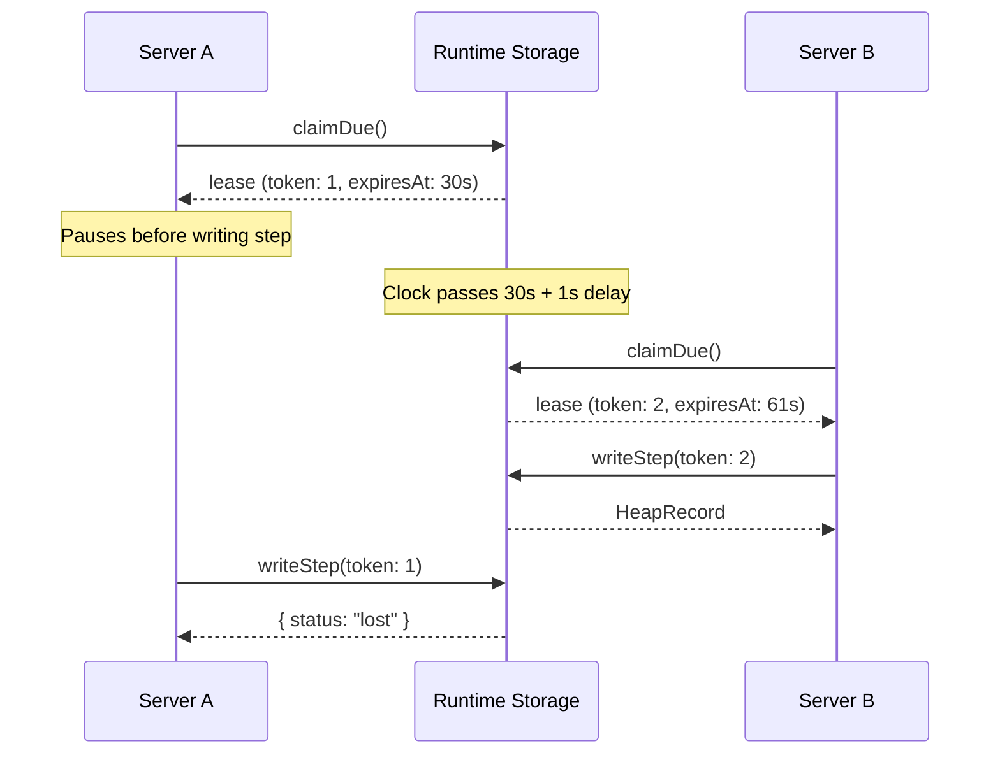

# Leases & Delivery

`ExecutionDispatcher` delivers due executions under time-bounded leases, and `ExecutionClient` and `HeapClient` reject stale writes using monotonic fencing tokens. Together, leases and fencing tokens let another server take over after a crash or network partition while preventing the paused server from corrupting step history.

## Leases and clock expiry

When an execution is due, `ExecutionDispatcher` calls `executions.claimDue({ limit, duration, filter })` and receives an `ExecutionLease`:

```ts [src/lease-types.ts]
type ExecutionLease = {
  executionId: string;
  token: number;
  expiresAt: number;
};
```

An execution has at most one live lease at a time across every runtime instance sharing the backend. While a delivery runs, `ExecutionDispatcher` renews the lease every `renewInterval` using `executions.renew`, and ends it with `executions.acknowledge` on completion or `executions.release` on failure.

By default, `ExecutionDispatcher` acquires 30,000 ms leases (`DEFAULT_LEASE_DURATION`) and renews every third of that interval (10,000 ms).

An expired lease remains current until another claim replaces it. If a server pauses past lease expiration without being superseded, renewals, acknowledgements, and step writes still succeed – clocks govern claim eligibility and live running status, never fencing validity.



## Fencing tokens and `LeaseLost`

Each claim issues a fencing token strictly greater than every previous token for that execution. Forced cancellation also bumps `leaseToken` and clears the lease expiration, immediately fencing active workers.

Every fenced operation checks `isLeaseCurrent(state, lease)` inside the same atomic write:

| Method | Client |
| :--- | :--- |
| `renew` | `ExecutionClient` |
| `release` | `ExecutionClient` |
| `acknowledge` | `ExecutionClient` |
| `writeStep` | `HeapClient` |
| `recordCancellation` | `HeapClient` |

`isLeaseCurrent` verifies matching execution ID, non-null lease expiration, and equal `leaseToken` while intentionally ignoring clock expiration checks.

When a fenced check fails or the execution record does not exist, the method mutates nothing and returns `{ status: "lost" }` (`LeaseLost`). Keep the check and the mutation inside one atomic database operation:

```ts [src/fenced-write.ts]
import {
  acknowledgeExecution,
  isLeaseCurrent,
  type ExecutionAcknowledgeResult,
  type ExecutionLease,
  type WorkflowRunOutcome,
} from "@notation/durable/runtime";
import type { Pool } from "pg";
import { withTransaction } from "./postgres-tx";

export async function acknowledgeFenced(
  pool: Pool,
  lease: ExecutionLease,
  outcome: WorkflowRunOutcome,
  now: number
): Promise<ExecutionAcknowledgeResult> {
  return withTransaction(pool, async (tx) => {
    const state = await tx.getExecutionStateForUpdate(lease.executionId);
    if (!state || !isLeaseCurrent(state, lease)) {
      return { status: "lost" };
    }
    const { state: next, result } = acknowledgeExecution(state, { lease, outcome, now });
    if (next !== state) {
      await tx.updateExecutionState(next);
    }
    return result;
  });
}
```

When renewal observes a lost lease, `ExecutionDispatcher` stops renewing and aborts the delivery's signal with `LeaseLostError`. It waits up to `abortGracePeriod` for settlement without releasing or acknowledging the execution.

Inside the delivery, the SDK driver throws `InfrastructureError` wrapping `LeaseLostError` as soon as `signal` aborts or any fenced write returns `isLeaseLost(result)`.

The default `abortGracePeriod` is `1_000` ms, exported as `DEFAULT_ABORT_GRACE_PERIOD`.

## Why unfenced writes are safe

Fencing tokens guarantee that only one delivery's step records and outcome are committed. They do not stop a step function that already began executing before losing its lease from running external code twice – Notation Durable provides at-least-once step execution and relies on [External Effects](../core/external-effects.md) for idempotent side effects.

Non-fenced runtime methods are safe when called late by a paused delivery because each is idempotent by key:

| Write | Idempotency guarantee |
| :--- | :--- |
| `executions.start` | Keyed by caller execution ID and step key; repeats return the original child ID |
| `stores` | Applied-steps ledger keyed by store, execution ID, and step key replays recorded results |
| `effects` | Keyed by `effectId`; conflicting settlements keep the first outcome and record a conflict |
| `joins.join` | Upserting an existing waiter causes at most one extra wake on target completion |

## Unacknowledged deliveries and backoff

A delivery ends without an outcome when either `executions.release` is called after an error or a held lease expires and a later `claimDue` replaces it.

`ExecutionDispatcher` calls `release` when a delivery rejects with a non-fatal error. It leaves the lease to expire without releasing when `WorkerExitedError` is thrown or when reading, releasing, or acknowledging rejects. Letting the lease expire gives in-flight writes from a dying worker time to finish or be fenced before redelivery.

`ExecutionState` tracks consecutive unacknowledged deliveries in `unacknowledgedDeliveryCount` and sets a backoff window before the execution can be claimed again:

1. After a release, `redeliverAt` advances by the backoff for the current failure count.
2. After lease expiry, `nextClaimAt` measures the delay from expiration using one higher failure count.
3. Acknowledgement resets the unacknowledged failure counter to zero and clears `redeliverAt`. A newly recorded step also resets the counter.

`redeliveryDelay(count)` returns 0 for non-positive counts, starts at 1,000 ms (`REDELIVERY_DELAY_BASE`), and doubles per consecutive failure up to 300,000 ms (`REDELIVERY_DELAY_MAX`).

Use `unacknowledgedDeliveryCountAt(state, now)` for reads so expired held leases reflect an extra unacknowledged delivery immediately without needing a storage write.

Nothing stops redelivery by default. Set `maxExpiredDeliveries` on `ExecutionDispatcher` to fail an execution with a `DeliveryLimitError` after that many consecutive deliveries end with an expired lease. Released leases do not count.
