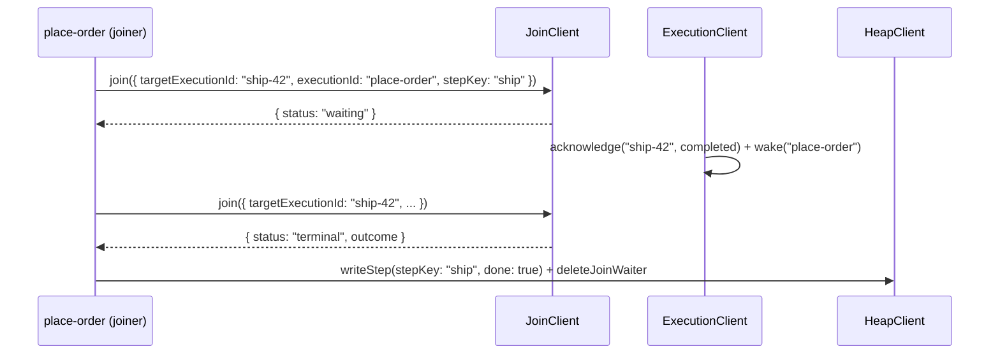

# Join Client

`JoinClient` records join waiters for executions waiting on other executions to reach a terminal status, backing `step.join` and `step.call` in [Child Workflows](../core/child-workflows.md).

## The JoinClient contract

`JoinClient` defines one method, `join(waiter)`, which inspects the target execution and records a `JoinWaiter` when still active. Call `readJoinTarget` from `@notation/durable/runtime` to compute the `JoinResult`:

| Target state | Result |
| :--- | :--- |
| Terminal | Returns `{ status: "terminal", outcome }` and registers no waiter |
| Active or suspended | Returns `{ status: "waiting" }` and registers the waiter |
| Missing | Returns `{ status: "not-found" }` and registers no waiter |

Completed, failed, and cancelled targets resolve as terminal, while admitted, running, and suspended targets keep waiting. Repeating `join` for the same target and caller step keeps a single waiter row and triggers no extra wake.

## Atomic target read and waiter registration

`join(waiter)` must read the target execution's state and conditionally upsert the waiter in one atomic transaction. If a target reaches a terminal status between an unlocked read and a separate waiter insert, the target's terminal acknowledgement will miss the waiter and the joining execution will stall indefinitely.

```ts [src/join-client.ts]
import {
  readJoinTarget,
  type JoinClient,
  type JoinResult,
  type JoinWaiter,
} from "@notation/durable/runtime";

export class CustomJoinClient implements JoinClient {
  async join(waiter: JoinWaiter): Promise<JoinResult> {
    return this.db.transaction(() => {
      const target = this.executions.getState(waiter.targetExecutionId);
      const result = readJoinTarget(target);
      if (result.status === "waiting") {
        this.joinWaiters.upsertWaiter(waiter);
      }
      return result;
    });
  }
}
```

Because `join` runs inside the same transaction boundary as terminal acknowledgements, concurrent joins and completions serialize cleanly: either the waiter commits before completion wakes it, or completion commits first and `join` observes the terminal outcome directly.

## Terminal wakes and waiter cleanup

`JoinClient` only reads target states and inserts waiters; waking joiners and cleaning up waiters live in [`ExecutionClient`](./execution-client.md) and [`HeapClient`](./heap-client.md):

| Operation | Waiter side effect |
| :--- | :--- |
| `ExecutionClient.acknowledge` | Wakes every join waiter on a newly terminal execution in the same transaction |
| `ExecutionClient.cancel` | Wakes join waiters on force-cancelled targets and deletes waiters held as a joiner |
| `HeapClient.writeStep` | Deletes waiters for the step and `deleteWaitersOf` steps when `done` is `true` |
| `HeapClient.recordCancellation` | Deletes waiters for every cancelled step recorded in that transaction |

`ExecutionClient.acknowledge` keeps join waiters in place after scheduling wakes; finished step writes, cancellation delivery, or forced execution cancels remove them.

Unfinished step writes where `done` is `false` keep the waiter registered so a timed `step.join` continues waiting until the step resolves or times out. If a joining execution is already terminal when its target completes, `ExecutionClient` ignores the wake.



## Why stale registrations are harmless

`JoinClient.join` is intentionally not fenced by a lease. A paused lease holder whose lease expired can still invoke `join` after the current holder has already recorded the step with `done: true`, or after a workflow deploy has removed a waiting `step.join` call.

Such a waiter stays in storage until `targetExecutionId` ends. At that point, `ExecutionClient.acknowledge` or forced `cancel` schedules one wake for `executionId`.

When that delivery replays, `WorkflowRunner` reads the already-recorded step from `HeapClient` or bypasses the removed step. A join waiter only requests a wake and never writes step records or execution outcomes, so stale registrations cause at most one harmless extra delivery.
