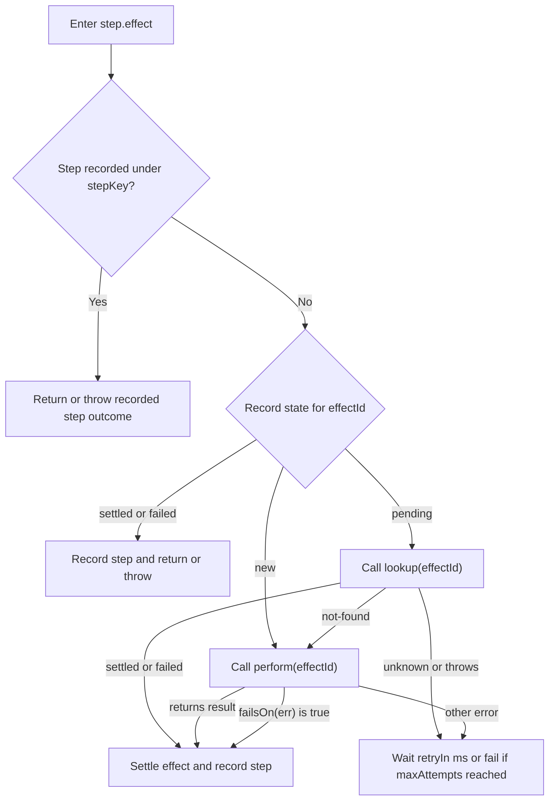

# External Effects

`step.run` executes step callbacks at least once, which creates a double-execution hazard for irreversible side effects such as charging a payment card. `step.effect` closes that gap by recording intent before calling the external API and checking the external system before ever running the operation a second time.

## The double-execution hazard

Consider charging a customer inside `step.run`:

```ts [src/workflows/unsafe-charge.ts]
import { workflow } from "@notation/durable";

export const unsafeCheckout = workflow<{ orderId: string; amount: number }>(
  async function* (step, event) {
    return yield* step.run("charge", async () => {
      return await payments.charge({
        orderId: event.params.orderId,
        amount: event.params.amount,
      });
    });
  }
);
```

If the worker crashes or loses its lease after `payments.charge` succeeds at the payment provider – but before Notation Durable writes the step record – the step has no recorded outcome. On the next delivery, `step.run` runs the callback again and charges the card twice.

`step.effect` prevents the duplicate charge by separating **checking what happened** (`lookup`) from **executing the operation** (`perform`).

## Defining an effect with `step.effect`

Pass a non-empty `stepKey` and an effect descriptor to `step.effect`:

```ts [src/workflows/charge-order.ts]
import { workflow } from "@notation/durable";

export const chargeOrder = workflow<{ orderId: string; amount: number }>(
  async function* (step, event) {
    const { orderId, amount } = event.params;

    const charge = yield* step.effect("charge", {
      effectId: `acme:charge:order-${orderId}`,
      operation: "charge-v1",
      input: { amount },
      retryIn: 60_000,

      lookup: async (effectId) => {
        const found = await payments.findByIdempotencyKey(effectId);
        return found
          ? { status: "settled", result: found }
          : { status: "not-found" };
      },

      perform: async (effectId) => {
        return await payments.charge({
          orderId,
          amount,
          idempotencyKey: effectId,
        });
      },
    });

    return charge;
  }
);
```

| Field | Description |
| :--- | :--- |
| `effectId` | Non-empty string naming the operation in the external system |
| `operation` | Non-empty string naming the version of `input`, `lookup`, and `perform` |
| `input` | Plain durable object describing the request arguments |
| `retryIn` | Finite non-negative milliseconds to wait before re-checking an uncertain attempt |
| `lookup` | Async function taking `effectId` and reporting the external state |
| `perform` | Async function taking `effectId` and executing the external operation |
| `failsOn` | Predicate identifying definite failure errors thrown by `perform` |
| `maxAttempts` | Positive integer limit on uncertain attempts before throwing `EFFECT_OUTCOME_UNKNOWN` |

`failsOn` and `maxAttempts` are optional. When `maxAttempts` is omitted, `step.effect` keeps polling every `retryIn` milliseconds until `lookup` or `perform` produces a settled result or definite failure.

Input objects and the results returned by `perform` and `lookup` must be [durable values](./step-values.md). A `perform` callback that returns nothing settles the effect with `undefined`.

### `stepKey` vs `effectId`

`stepKey` identifies a step inside one workflow execution, whereas `effectId` identifies the operation globally across executions, retries, and external tools. Construct `effectId` from the stable domain identifiers for that operation – such as account, action, and order ID – and never reuse an `effectId` for a different operation.

Effect records outlive individual workflow executions. Cancelling an execution while an effect is pending does not abort the external operation or delete the effect record.

## Decision flow

Durable stores a persistent record for each `effectId`. On the first run, Durable marks the `effectId` pending before calling `perform`; on any later attempt where the record is still pending, Durable calls `lookup` first so it never blindly runs `perform` twice.



`lookup(effectId)` must resolve to one of four `EffectLookup` outcomes:

| Status | Meaning |
| :--- | :--- |
| `{ status: "settled", result }` | Operation succeeded with `result` |
| `{ status: "failed", error }` | Operation failed permanently with `error` |
| `{ status: "not-found" }` | No operation was accepted, none is running, and none can still complete |
| `{ status: "unknown" }` | External state is not yet determinable |

Once an effect settles with a result or definite failure, its record is permanent. Any step or execution sharing that `effectId` receives the stored outcome without calling `lookup` or `perform` again.

## Definite failures and uncertain retries

By default, any error thrown by `perform` – such as a network timeout, socket hang-up, or 5xx response – leaves the outcome **uncertain**. Durable suspends the step for `retryIn` milliseconds and calls `lookup` on the next delivery.

Use `failsOn` to mark errors that prove the external operation did not happen and never will, such as a declined card or invalid payment token:

```ts [src/workflows/charge-with-fails-on.ts]
import { WorkflowEffectError, workflow } from "@notation/durable";

class CardDeclinedError extends Error {
  code = "CARD_DECLINED";
}

export const chargeOrder = workflow<{ orderId: string; amount: number }>(
  async function* (step, event) {
    try {
      return yield* step.effect("charge", {
        effectId: `acme:charge:order-${event.params.orderId}`,
        operation: "charge-v1",
        input: { amount: event.params.amount },
        retryIn: 60_000,
        maxAttempts: 5,

        lookup: async (effectId) => {
          const found = await payments.findByIdempotencyKey(effectId);
          return found
            ? { status: "settled", result: found }
            : { status: "not-found" };
        },

        perform: async (effectId) => {
          return await payments.charge({
            orderId: event.params.orderId,
            amount: event.params.amount,
            idempotencyKey: effectId,
          });
        },

        failsOn: (err) => err instanceof CardDeclinedError,
      });
    } catch (err) {
      if (err instanceof WorkflowEffectError && err.code === "EFFECT_OUTCOME_UNKNOWN") {
        // Outcome remained unknown after 5 attempts; escalate for manual reconciliation.
        return { status: "needs-review" as const };
      }
      throw err;
    }
  }
);
```

When `perform` throws an error and `failsOn(err)` returns `true`, Durable settles the effect as failed, records the error on the step, and throws it into workflow code. Retrying a definitely failed operation requires a new `effectId`.

Return `false` from `failsOn` for timeouts, connection resets, and ambiguous server errors; Durable never invokes `failsOn` for errors thrown by `lookup`.

When `maxAttempts` uncertain attempts finish without settling, `step.effect` stops waiting and throws `WorkflowEffectError` with code `EFFECT_OUTCOME_UNKNOWN` while leaving the effect record pending. Setting `maxAttempts` to 1 throws `EFFECT_OUTCOME_UNKNOWN` immediately on the first uncertain attempt without suspending.

## Idempotency requirements on the external API

`step.effect` prevents double execution only when the external API upholds five guarantees for each effect ID:

- **Idempotent execution** – Repeated or concurrent calls to `perform` execute at most one operation and return one consistent result. Pass `effectId` as the API's idempotency key.
- **Strict absence check** – Return `{ status: "not-found" }` from `lookup` only when no operation was accepted, none is currently in flight, and no prior call can still finish. Returning not-found for an in-flight call causes `step.effect` to call `perform` again.
- **Immutable settlement** – A settled status always returns the same result produced by execution and never changes afterward.
- **Permanent failure** – A failed lookup result or an error matched by `failsOn` guarantees the operation did not succeed and cannot succeed later.
- **Honest unknown status** – When the API cannot confirm success, failure, or absence, `lookup` returns `{ status: "unknown" }` or rejects so Durable retries later.

## Validation, mismatches, and conflicts

Durable validates effect descriptors and tracks request consistency across deliveries and concurrent workers:

| Code | Cause |
| :--- | :--- |
| `INVALID_EFFECT_REQUEST` | Descriptor fields or `input` failed validation |
| `EFFECT_REQUEST_MISMATCH` | `operation` or `input` changed for an existing `effectId` |

If a deploy changes the operation name or input payload for an already-recorded effect ID – such as changing the charge amount without changing the ID – `step.effect` throws `WorkflowEffectError` with `EFFECT_REQUEST_MISMATCH` before calling `lookup` or `perform`.

Keep the same `effectId` when updating `lookup` or `perform` logic only if the new callbacks preserve the same external contract.

If two callers settle the same `effectId` concurrently with different outcomes, the first recorded outcome wins. Durable logs a warning and records the discrepancy as a conflict on the effect record.
