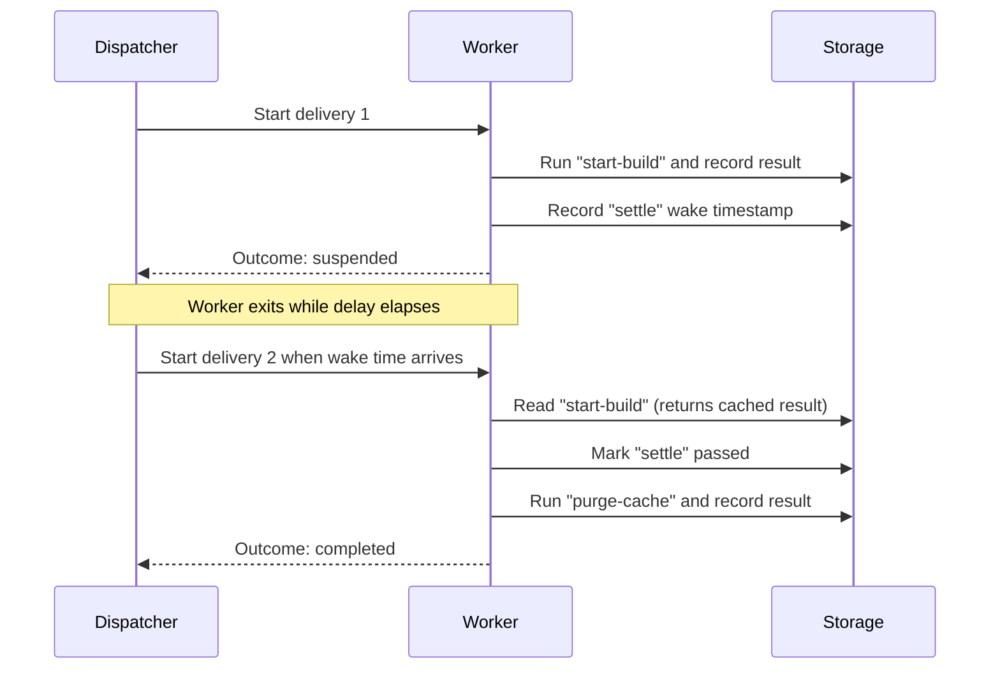

# Steps

Steps perform actions, pauses, and polling inside a workflow. Notation Durable records each step's outcome under its key so replays return saved results instead of running finished work again.

```ts [src/workflows/deploy-site.ts]
import { workflow } from "@notation/durable";
import { builds, cdn, hosting } from "../services";

export const deploySite = workflow<{ siteId: string }, void>(async function* (
  step,
  event
) {
  const { siteId } = event.params;

  const build = yield* step.run("start-build", async () => {
    return await builds.start(siteId);
  });

  yield* step.poll(
    "wait-for-build",
    { retryInterval: 10_000, maxAttempts: 30 },
    async () => {
      const status = await builds.status(build.id);
      return status === "finished";
    }
  );

  yield* step.run("publish", async () => {
    await hosting.publish(siteId, build.id);
  });

  yield* step.delay("settle", 5 * 60_000);

  yield* step.run("purge-cache", async () => {
    await cdn.purge(siteId);
  });
});
```

## `step.run`

`step.run` executes a synchronous or async function once and records its return value:

```ts [src/workflows/deploy-site.ts]
const build = yield* step.run("start-build", async () => {
  return await builds.start(siteId);
});
```

On both the initial run and every subsequent replay, `step.run` returns the decoded copy of the recorded value so workflow code always observes the same representation.

If the step function throws a standard error, `step.run` records it and throws it into the workflow for handling. When it throws `RetryableError`, the step suspends and retries up to its configured attempt limit and interval before throwing the final error (see [Errors & Retries](./errors-and-retries.md)).

You can also pass `{ schema }` as the options argument (`step.run("start-build", fn, { schema })`) using any Standard Schema validator to validate the decoded value on the first run and on every replay. See [Step Values](./step-values.md) for schema validation.

## `step.delay`

`step.delay` pauses execution for a duration in milliseconds:

```ts [src/workflows/deploy-site.ts]
yield* step.delay("settle", 5 * 60_000);
```

When `step.delay` is reached for the first time, it computes the wake timestamp from the runtime clock (`clock() + ms`) and suspends the delivery. No worker stays alive during the wait.

Once the wake time passes, the dispatcher starts a new delivery, marks the delay as passed, and resumes past it. Subsequent replays pass a completed delay immediately without consulting the clock again.

## `step.poll`

`step.poll` evaluates a synchronous or async predicate on an interval until it returns `true`:

```ts [src/workflows/deploy-site.ts]
yield* step.poll(
  "wait-for-build",
  { retryInterval: 10_000, maxAttempts: 30 },
  async () => {
    const status = await builds.status(build.id);
    return status === "finished";
  }
);
```

| Option | Description |
| :--- | :--- |
| `retryInterval` | Milliseconds to wait between predicate checks |
| `maxAttempts` | Maximum number of checks to perform, including the first |

Each check follows the predicate's return value or thrown error:

| Predicate result | Step behavior |
| :--- | :--- |
| Returns true | Completes with `void` and advances the workflow |
| Returns false | Retries every `retryInterval` ms until `maxAttempts` checks fail with `RetryableError` |
| Throws an error | Records the error and throws without further attempts |

Both `RetryableError` and errors thrown by the predicate can be caught with `try` / `catch`.

## Deliveries and replay

Every time a worker picks up an execution, it runs a **delivery** starting from the first line of the workflow generator:



Steps that already have a finished record return their saved value (or rethrow their saved error) without executing their callback again. Only steps with no finished record run live.

## Execution statuses

Every execution has one of six statuses exposed through the SDK:

| Status | Description |
| :--- | :--- |
| `admitted` | Execution is recorded and no delivery has finished yet |
| `running` | A worker is currently running a delivery for the execution |
| `suspended` | Last delivery paused at a delay, poll, retry backoff, store wait, effect, or join |
| `completed` | Workflow returned a value and finished |
| `failed` | Workflow threw an uncaught error or produced an invalid value |
| `cancelled` | Execution stopped due to a cancellation request |

`completed`, `failed`, and `cancelled` are terminal statuses. Once an execution reaches a terminal status, Durable never delivers workflow code for it again.

## Step keys

Every step has a string key that identifies its recorded outcome within an execution. When a workflow replays, Durable matches each step to its stored record by key.

```ts [src/workflows/reminders.ts]
const overdue = yield* step.run("load-overdue", async () => {
  return await invoices.overdue(customerId);
});
```

### Unique keys and loops

No two steps in the same execution may share a key. If an execution reaches a key that has already been used in the same delivery, Durable fails the execution immediately with `Each step in a loop must have a unique cache key.`.

Workflow `try` / `catch` blocks cannot catch this error. Inside a loop, include a per-iteration identifier such as an entity ID or loop index in the step key:

```ts [src/workflows/reminders.ts]
for (const invoice of overdue) {
  yield* step.run(`remind:${invoice.id}`, async () => {
    await mailer.sendReminder(invoice);
  });
}
```

Every step other than `step.run`, `step.delay`, `step.poll`, and untimed `store.when` requires an explicit key.

### Keyless steps

`step.run`, `step.delay`, and `step.poll` allow omitting the key argument:

```ts [src/workflows/reminders.ts]
const overdue = yield* step.run(async () => {
  return await invoices.overdue(customerId);
});
```

When you omit the key, Durable hashes the call site's file path, line, and column to generate a key automatically. Relying on source positions introduces two risks:

- **Code edits shift keys** – Adding or removing lines above the step, reformatting, moving the file, or changing bundler output produces a different call-site hash. If a suspended execution replays after that deploy, Durable finds no record under the new hash and executes the step again.
- **Loops fail immediately** – Every pass through a loop calls the same source line and column, so the second iteration hits the duplicate key error.

Always provide explicit string keys in production workflows so records stay stable across edits and deploys.

## Changing workflows across deploys

Durable matches step records solely by step key rather than by step order or index. When you deploy updated workflow code while executions are suspended, the next delivery behaves according to how the keys changed:

| Code change | Next delivery behavior |
| :--- | :--- |
| Remove a finished step | Stored record for that key is ignored |
| Add a new step before the suspended point | New step executes and records its result |
| Rename a finished step key | Step executes again under the new key |
| Change code inside a finished step | Stored result is returned without running the new code |
| Reorder finished steps | Each step receives its own stored result by key |

Keep a step's key unchanged when updating its code unless suspended executions must re-run that step with the new implementation.
