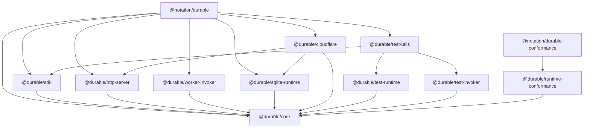

# Architecture

Notation Durable separates contracts, workflow execution, HTTP serving, worker isolation, SQLite storage, Cloudflare hosting, and conformance suites into ten private `@durable/*` workspace packages. At publish time, `tsup` bundles those packages into `@notation/durable` and `@notation/durable-conformance` so applications and workers share one runtime identity.

## Workspace packages

Dependencies flow downward to `@durable/core`, which defines client contracts, codecs, errors, and state transitions with no workspace dependencies:

| Package | Responsibility |
| :--- | :--- |
| `@durable/core` | Client contracts, `WorkflowRunner`, `ExecutionDispatcher`, value codec, and state transitions |
| `@durable/sdk` | Workflow generator driver, step runners, local SDK, HTTP SDK, and step record codec |
| `@durable/http-server` | Framework-agnostic trigger, poll, wait, list, and cancel HTTP handlers |
| `@durable/worker-invoker` | Child-process worker launcher, IPC protocol, and orphan exit handling |
| `@durable/sqlite-runtime` | SQLite schema, runtime clients, and `bun:sqlite` or `node:sqlite` drivers |
| `@durable/cloudflare` | Durable Object SQLite driver and the alarm-driven workflow object |
| `@durable/test-runtime` | In-memory `Runtime` implementation with a controllable clock |
| `@durable/test-invoker` | In-process `WorkflowInvoker` driving `WorkflowRunner` without spawning workers |
| `@durable/test-utils` | Test harness combining `MemoryRuntime`, in-process invoker, and `createTestSdk` |
| `@durable/runtime-conformance` | Vitest conformance suites for execution, heap, store, effect, join, and cancellation |

## Published entrypoints

The `@notation/durable` package compiles ten ESM entrypoints with code splitting enabled so internal workspace packages share common chunks inside one distribution. External dependencies such as Standard Schema, Pino, Vitest, and host SQLite bindings remain external imports.

| Entrypoint | Responsibility |
| :--- | :--- |
| `@notation/durable` | Workflow authoring, local SDK, router, dispatcher, runner, and error classes |
| `@notation/durable/client` | Browser-safe HTTP SDK factory and client request errors |
| `@notation/durable/runtime` | Runtime client contracts, state transitions, value codec, and runner primitives |
| `@notation/durable/http` | HTTP route handlers and observation middleware |
| `@notation/durable/worker` | Child-process worker invoker and worker entrypoint helpers |
| `@notation/durable/sqlite` | `SqliteRuntime` and SQLite client implementations for custom drivers |
| `@notation/durable/sqlite/bun` | SQLite runtime and `createSqliteDb` backed by `bun:sqlite` |
| `@notation/durable/sqlite/node` | SQLite runtime and `createSqliteDb` backed by `node:sqlite` |
| `@notation/durable/cloudflare` | `createWorkflowObject` and the SQLite driver for Durable Object storage |
| `@notation/durable/testing` | `MemoryRuntime`, in-process invoker, and `createTestSdk` |
| `@notation/durable-conformance` | Published Vitest runtime conformance suites |

## Single-copy class instance invariant

`WorkflowRunner`, the workflow generator driver, and the step record codec rely on `instanceof` checks across step response subclasses and core workflow errors. Loading two copies of the core package in one process breaks those boundary checks and causes `WorkflowRunner` to reject with a version-mismatch error.

To keep one class hierarchy in consumer test suites, `@notation/durable-conformance` maps its core imports onto `@notation/durable/runtime` at build time. Published conformance tests therefore instantiate and inspect the exact classes from the caller's installed `@notation/durable` package.

## App, server, and worker roles

Deployments split responsibilities across three process roles using focused subpaths:

| Role | Imports and responsibility |
| :--- | :--- |
| App | Imports `@notation/durable/client` or `@notation/durable` to trigger, poll, wait on, list, and cancel executions |
| Server | Imports `@notation/durable`, `@notation/durable/http`, `@notation/durable/worker`, and a runtime to serve routes and dispatch leases |
| Worker | Imports `@notation/durable`, `@notation/durable/worker`, and a runtime to run workflow generators in an isolated process |
