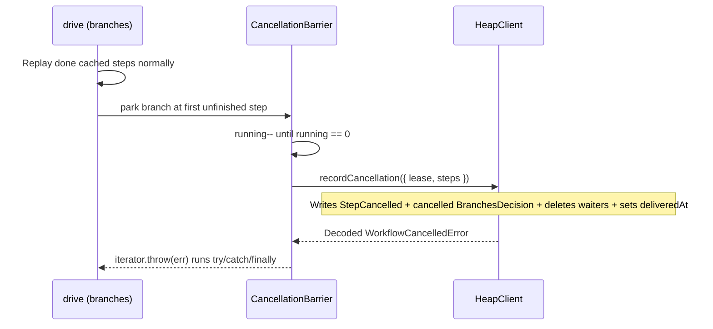

# Cancellation

Notation Durable records cancellation requests on the execution record, delivers graceful cancellations atomically across active branches through `CancellationBarrier`, and terminates forced cancellations immediately by fencing active leases and clearing waiters.

## Request metadata and modes

`ExecutionRecord.cancellation` persists across five columns on the `executions` table:

| Field | Purpose |
| :--- | :--- |
| `reason` | Optional text from the first cancellation request |
| `source` | Root execution ID when propagated to attached descendants |
| `forced` | True for forced cancellation and false for graceful delivery |
| `requestedAt` | Clock timestamp when cancellation was first recorded |
| `deliveredAt` | Clock timestamp stamped once when delivered to workflow code |

The original `reason` and `source` remain fixed after the first request, whereas a later forced request escalates the flag to true. `requestExecutionCancellation` handles the two modes differently:

- **Graceful mode** – Keeps the execution non-terminal and pulls `dueAt` to run workflow cleanup handlers on the next delivery.
- **Forced mode** – Marks non-terminal executions cancelled immediately, persists the terminal outcome, clears lease and schedule timestamps, and bumps `leaseToken` without running workflow code.

## Graceful delivery via `CancellationBarrier`

The workflow driver (`packages/sdk/src/exports/workflow.ts`) initializes `CancellationBarrier` (`packages/sdk/src/internal/branches.ts`) only when `cancellation.deliveredAt === undefined`:

`CancellationBarrier` initializes its active count at 1 and tracks concurrent combinator branches through enter and leave guards. Completed cached steps replay normally without parking, and combinator container keys never pause on cancellation because child branches enter the barrier individually.

Each branch parks at its first unfinished non-combinator step:

- **Unrecorded or unfinished steps** – Steps with no record or a retry or wait state park at their current attempt index.
- **Active delays** – Unexpired delays park at attempt 1, leaving the original `StepDelay` record intact.

If a sibling settles a combinator before the barrier flushes, parked losing branches release with `STOPPED` so they exit without writing `StepCancelled`.

Once active count hits zero, the barrier marks enclosing unsettled combinators cancelled and commits via `heapClient.recordCancellation`. In one synchronous `IMMEDIATE` transaction, the runtime verifies the lease, writes `StepCancelled` and combinator decisions, deletes satisfied waiters, and stamps delivery time before throwing `WorkflowCancelledError` into each generator.

## `StepCancelled` vs `StepError`

`StepCancelled` uses a distinct step record type from `StepError` so a user step manually throwing `WorkflowCancelledError` keeps ordinary error and retry semantics. On replay, the driver injects a recorded cancellation directly at the step key without entering execution.

`WorkflowRunner.run` resolves with cancelled status only when an uncaught cancellation error escapes a delivery carrying a pending or delivered cancellation request; otherwise the execution fails. Execution acknowledgement rejects any cancelled outcome if no cancellation record exists.

## Forced cancellation, lease abort, and child cleanup

`SqliteExecutionClient.cancel` runs inside one `IMMEDIATE` transaction and walks breadth-first across non-terminal attached children. Children started with detached mode stay independent of parent cancellation and do not inherit pending parent cancellation at admission.

For each force-cancelled execution, incrementing `leaseToken` and clearing the lease expiration invalidates any active worker lease immediately:

1. **Lease abort** – Any subsequent fenced heap write or lease renewal observes a lost lease, firing the delivery's `AbortController` with `LeaseLostError`.
2. **Waiter cleanup** – Forced cancellation deletes all rows belonging to the cancelled execution from `store_waiters`, `effect_waiters`, and `join_waiters`.
3. **Joiner wakes** – Waiting parents or joiners are scheduled immediately while keeping `join_waiters` rows until each joiner records its step.
