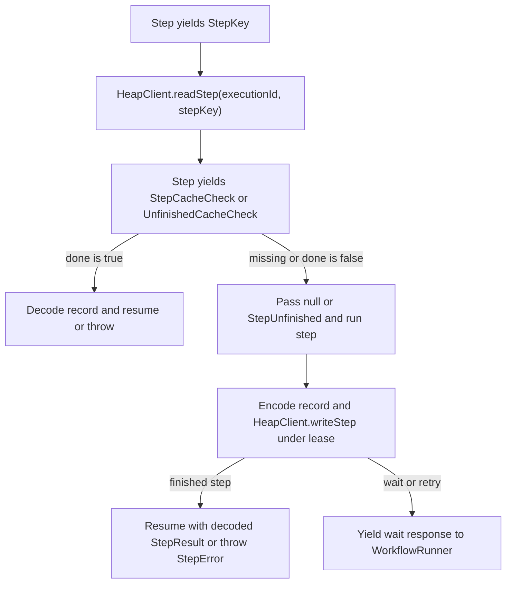

# Replay & Step Heap

On every delivery, Notation Durable opens the workflow generator from the beginning and replays recorded step outcomes from the heap until the workflow returns, throws, or suspends on an unfinished step. Persisted `StepResponse` records freeze past results, errors, delays, and branch decisions so repeated deliveries follow identical control flow without re-running completed work.

## Delivery lifecycle in `WorkflowRunner`

`WorkflowRunner.run` resolves the registered generator for the delivery event, invokes it with the active lease, abort signal, and runtime clients, and advances the outer iterator:

- **Completed return** – When the generator returns, the driver persists a `WorkflowResult` under the reserved result key and the runner resolves as completed.
- **Thrown error** – Uncaught errors settle as failed, or as cancelled when the delivery carried a cancellation request and threw `WorkflowCancelledError`. Rejected `InfrastructureError` values escape instead of returning an outcome so the lease stays unacknowledged.
- **Suspended wait** – When the generator yields a delay, effect wait, store wait, or join wait response, the runner maps it to a suspended outcome with its wake timestamp.

## Step key and cache-check protocol

Every step runner communicates with the `workflow` driver through a two-yield handshake before executing work or reading a cached outcome:

1. **Declare key** – The step yields a `StepKey`. The driver verifies per-delivery uniqueness, reads any cached entry via `HeapClient.readStep`, and advances the attempt counter past the latest stored attempt.
2. **Check cache** – The step yields a cache-check token. When a finished record exists on the heap, the driver decodes the stored JSON and returns or throws the recorded outcome without executing the step function.
3. **Commit attempt** – When no finished record exists, the step executes, performs any runtime calls, and yields its `StepResponse`. The driver encodes the record, persists it via `HeapClient.writeStep` under the active lease, and feeds the decoded response back into the step so the first run sees the exact same decoded value as replay.

## Persisted `StepResponse` records

The step record codec serializes and revives persisted `StepResponse` records:

| Record | Replay behavior |
| :--- | :--- |
| `StepResult` | Marked `done: true`; resumes the step with the decoded durable value and optional schema verdict |
| `StepError` | Marked `done: true` when terminal, or `done: false` as `StepRetrying` when retries remain |
| `StepCancelled` | Marked `done: true`; throws the recorded `WorkflowCancelledError` at the step key |
| `StepDelay` | Marked `done: true` with `wakeAt`; suspends while `wakeAt` exceeds the runtime clock |
| `StepDelayPassed` | Marked `done: true`; resumes immediately past the delay without checking the clock again |
| `StepStoreWait` | Marked `done: false`; stores optional deadline `wakeAt` and re-evaluates the store selector on replay |
| `StepJoinWait` | Marked `done: false`; stores optional deadline `wakeAt` and re-checks the target execution on replay |
| `StepEffectWait` | Marked `done: false`; stores next `wakeAt` so the following delivery runs `lookup` before retrying |
| `StepBranchesDecision` | Marked `done: true`; replays the settled outcome for a `step.all` or `step.race` combinator |
| `WorkflowResult` | Marked `done: true` under `WORKFLOW_RESULT_STEP_KEY`; preserves the workflow return value |
| `StepInvalid` | Marked `done: true`; records a non-step or un-yielded generator value and throws immediately |

Finished records short-circuit step execution on every later delivery, whereas unfinished records advance the attempt number and re-run the step on the next wake. Once a `StepDelay` passes its wake time, the next delivery records `StepDelayPassed` at the next attempt so subsequent replays remain deterministic even if the clock changes.

Standard steps use `StepCacheCheck` and treat unfinished records as missing, whereas join steps and timed store waits yield `UnfinishedCacheCheck` to receive `StepUnfinished` so their original deadline stays fixed across replays.

## Replay safety invariants

Three guards keep heap state consistent when workflow code changes, loops repeat keys, or deliveries overlap:

| Invariant | Enforcement |
| :--- | :--- |
| Duplicate key detection | Rejects any repeated `stepKey` within one delivery before reading or writing the heap |
| Write conflict detection | Throws `InfrastructureError` wrapping `StepConflictError` when `HeapClient.writeStep` returns a mismatched row |
| Schema verdict persistence | Persists `"accepted"` or `"rejected"` in `StepResult` so loosened schemas cannot revive failed outputs |

`HeapClient.writeStep` never overwrites an existing attempt record and always resolves with the stored row. If another delivery committed a different response or completion flag first, raising `StepConflictError` aborts the losing delivery without acknowledging so the next delivery replays the winning record.

When `step.run` supplies a schema, the first delivery encodes the output, decodes it, validates the decoded value, and records whether the schema accepted or rejected it. If replay later checks a loosened schema against a rejected record, the step throws `WorkflowValueError` with code `STEP_SCHEMA_INVALID`.
