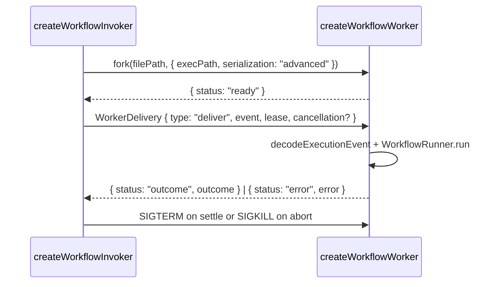

# Worker IPC

Notation Durable isolates workflow execution in forked child processes through `@durable/worker-invoker` (`packages/worker-invoker/src/worker-invoker.ts` and `packages/worker-invoker/src/worker.ts`). `createWorkflowInvoker` forks one worker process per delivery, completes a readiness handshake over Node IPC, and tears down the child on settlement, lease loss, or parent disconnect.

## Lifecycle and handshake

Before forking, `createWorkflowInvoker` rejects with `InfrastructureError` if the delivery signal is already aborted. Otherwise it resolves any file URL `workerPath` and spawns the worker with advanced IPC serialization.

The parent waits up to `handshakeTimeout`, defaulting to `5_000` ms, for `{ status: "ready" }` before dispatching `WorkerDelivery`. Holding the event back turns a mismatched runtime or missing `listen()` call into a clear handshake timeout instead of a silent hang.



```ts [packages/worker-invoker/src/worker.ts]
export type WorkerMessage =
  | { status: "ready" }
  | { status: "outcome"; outcome: SerializedOutcome }
  | { status: "error"; error: string };

export type WorkerDelivery = {
  type: "deliver";
  event: Omit<WorkflowEvent, "params" | "context"> & { params: string; context: string };
  lease: ExecutionLease;
  cancellation?: ExecutionCancellation;
};
```

| Frame | Direction and payload |
| :--- | :--- |
| `"deliver"` | Parent sends `WorkerDelivery` with `encodeExecutionEvent` payloads, `lease`, and optional `cancellation` |
| `"ready"` | Child signals that `process` IPC listeners are attached |
| `"outcome"` | Child returns `SerializedOutcome` after `WorkflowRunner.run` resolves |
| `"error"` | Child returns an `encodeThrownValue` string when decoding or running throws |

## Execution in isolation

Inside the child process, `createWorkflowWorker` decodes incoming parameters and context via `decodeExecutionEvent`, stores the context map for `getContext()`, and calls `WorkflowRunner.run` directly against its own backing runtime. The worker supplies an idle local `AbortController` because lease loss kills the child process directly.

`serializeOutcome` prepares `WorkflowRunOutcome` for IPC return:

- **`"suspended"` and `"cancelled"`** – Forwarded directly inside `SerializedOutcome` without re-encoding.
- **`"completed"`** – Encodes the return value via `durableValueCodec`, or turns non-durable outputs into a failure carrying `WorkflowValueError` (`INVALID_STEP_VALUE`).
- **`"failed"` and thrown errors** – Encodes workflow failures via `encodeThrownValue` inside the outcome, and catches unexpected runner or decode exceptions into error frames.

The parent revives outcome and error frames using `durableValueCodec.decode` (see [Value Codec & Errors](./value-codec.md)).

## Termination and orphan safety

The invoker and worker enforce four process-termination boundaries so lost or unrenewed leases cannot issue stale fenced writes:

- **Clean settlement** – Receiving an outcome or error frame, hitting `handshakeTimeout`, or failing to send sends `SIGTERM`.
- **Lease loss abort** – Aborting the delivery signal sends `SIGKILL` immediately and rejects with `InfrastructureError` so blocked code cannot perform another fenced write.
- **Parent disconnect** – When the IPC channel closes, the worker logs an error and exits immediately with code 75 (`WORKER_ORPHANED_EXIT_CODE`) before another runtime claims the lease.
- **Unexpected exit** – Any child exit before replying rejects with `WorkerExitedError` so `ExecutionDispatcher` lets the lease expire safely instead of releasing it prematurely.

For how `ExecutionDispatcher` handles `WorkerExitedError` and lease renewal, see [Leases & Dispatcher](./leases-and-dispatcher.md).
